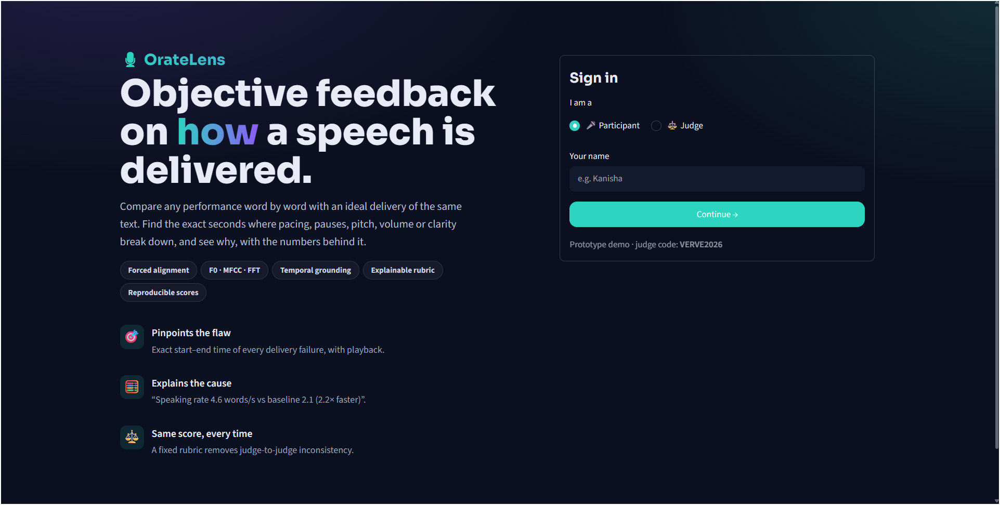

# OrateLens 🎙️



**Objective, explainable feedback on *how* a speech is delivered.**
Built for **Verveathon 2K26 · PS1: Counterpointing Speech Analytics & Temporal Flaw Finding** by **Kanisha M** and **Nive** (Sona College of Technology).

OrateLens compares a participant's delivery **word by word** with an ideal delivery of the **same text**, finds the exact
time regions where pacing, pauses, pitch, volume or clarity break down, explains each flaw with the numbers behind it,
and gives a reproducible rubric score in an interactive dashboard with **Participant** and **Judge** views.

---

## The problem
Judging spoken performances (interpretive reading, declamation, oratory) is subjective: different judges give different
scores, and participants get vague feedback like "work on your pacing". There is also no dataset that maps good delivery
against bad deliveries of the exact same text.

## What OrateLens does
| PS1 requirement | How we meet it |
|---|---|
| 1. Custom contrastive dataset | JFK's 1961 inaugural address excerpt as the **ideal baseline**; **4 human recordings** of the same text with increasing flaws (near-perfect → egregious); **18 synthetic recordings** with flaws injected at exactly known times and 4 severity levels; all labeled with start/end times in `data/labels.csv` |
| 2. Forced alignment + features | Every transcript word is aligned to the audio (faster-whisper word timestamps + difflib). Features every 20 ms: **F0 pitch (pYIN), RMS energy, spectral centroid & flatness, 13 MFCCs, FFT spectrum**; per word: **speech rate, pause (measured from silence), pitch range, loudness, clarity** |
| 3. Temporal grounding + causal explanations | Word *i* of the participant is compared with word *i* of the baseline using z-scores; consecutive deviating words merge into **flaw regions with exact start/end times**, each with a numeric explanation, e.g. *"0:14–0:15: pause of 1.58 s before 'places' vs baseline 0.00 s (z = +3.1)"* |
| 4. Interactive dashboard | Upload or record audio + transcript → **time-series overlay of participant vs baseline** with shaded flaw regions, flaw cards with **▶ play yours / ▶ play baseline**, FFT & MFCC comparison, progress tracking, judge leaderboard |

## Key ideas (innovation)
1. **Text-aware comparison:** good delivery depends on the words. A dramatic pause before *"ask not"* is a strength; the same pause mid-phrase is a flaw. Comparing against an ideal delivery of the same text captures this, unlike fixed thresholds.
2. **Self-validating dataset:** synthetic flaws are injected at known timestamps, so accuracy is measurable (temporal IoU, recall, precision), and the overall score is checked to fall as severity rises.
3. **Fair across voices and microphones:** pitch is measured in semitones relative to each speaker's own median, loudness relative to each speaker's own level.
4. **Reproducible scoring:** no LLM and no randomness. Each rubric criterion = `max(0, 10 − 2 × mean|z|)`, overall = sum × 2 (0–100).
5. **Time-warped overlay:** the baseline is warped onto the participant's timeline using the word alignment, so both curves show the same words at the same x position.

## Results
Run `python pipeline/evaluate.py` to reproduce (written to `data/eval.json`, shown in the app's *Dataset & evaluation* tab).

### Score by Severity
The mean overall score decreases monotonically as flaw severity increases:

| Severity Level | Description | Mean Overall Score (0–100) |
|:---:|---|:---:|
| **0** | Baseline / Ideal Delivery | **100.0** |
| **1** | Level 1 (Near-perfect / Minor flaws) | **94.0** |
| **2** | Level 2 (Mild flaws) | **93.6** |
| **3** | Level 3 (Moderate flaws) | **92.4** |
| **4** | Level 4 (Egregious flaws) | **86.4** |

### Per-Flaw-Type Detection Performance
Evaluated against labeled ground-truth flaw regions in `data/labels.csv` (Hit criterion: IoU $\ge$ 0.30):

| Flaw Type | Labeled Regions | Recall | Precision | Mean IoU |
|---|:---:|:---:|:---:|:---:|
| **Long Pause** (`long_pause`) | 7 | 0.71 | 0.45 | 0.66 |
| **Low Volume** (`low_volume`) | 10 | 0.30 | 0.43 | 0.26 |
| **Monotone** (`monotone`) | 5 | 0.20 | 0.33 | 0.13 |
| **Rushed** (`rushed`) | 12 | 0.17 | 0.15 | 0.14 |
| **Unclear** (`unclear`) | 10 | 0.30 | 0.27 | 0.24 |

## App
- **Participant:** record / upload / pick a sample → analysis (scores, overlay, flaw cards with playback, highlighted transcript, spectrum) → **My progress** (score trend, radar of first vs latest attempt, focus tips for the weakest criteria).
- **Judge** (demo access code `VERVE2026`): **leaderboard**, **radar comparison** of participants, **inspect** any participant's full analysis, dataset & evaluation, how it works.

## Project structure
```
app.py                     Streamlit dashboard (login, participant & judge views)
pipeline/align.py          forced alignment of transcript words to audio
pipeline/features.py       frame + word acoustic features, FFT, MFCC
pipeline/compare.py        z-scores, flaw regions, explanations, rubric, overlay warp
pipeline/analyze.py        runs the whole pipeline, caches results
pipeline/evaluate.py       evaluation against labels (score by severity, IoU)
data/make_synthetic.py     generates synthetic flawed recordings + labels.csv
data/baseline/             JFK baseline recording
data/flawed/human/         human recordings with increasing flaws
data/flawed/synthetic/     synthetic flawed recordings
data/transcripts/jfk.txt   the shared transcript
data/labels.csv            ground-truth flaw labels
```

## Run it
Requirements: Python 3.10–3.12 and **ffmpeg** on the PATH.
```bash
python -m venv .venv
.venv\Scripts\activate          # Windows  (macOS/Linux: source .venv/bin/activate)
pip install -r requirements.txt
python data/make_synthetic.py   # (optional) regenerate the synthetic dataset + labels
python pipeline/evaluate.py     # (optional) evaluation numbers
streamlit run app.py
```

## Limitations & next steps
- One baseline speaker today → add more baselines (TED speakers, debate champions) and compare against their average.
- New scripts need one ideal recording as the baseline; a text-independent mode would compare against norms from many good speakers.
- Whisper-based alignment can drift on heavily mumbled audio (flagged as *unclear*); next: wav2vec2 CTC forced alignment.
- Detection thresholds (|z| > 1.8) are hand-set; next: tune them on a larger labeled dataset.

## AI disclosure
We used AI coding assistants (Google Antigravity agents and Claude) to generate parts of the code under our step-by-step
direction. Problem framing, the contrastive dataset (recordings, flaw-injection design and labels), testing and the
presentation are our own work.
